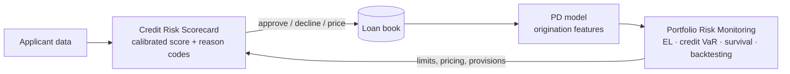

# Credit Risk Lifecycle: from scoring to portfolio monitoring

End-to-end credit risk modelling: deciding who to lend to, then watching how the loan book behaves once the money is out. Two projects, one lifecycle.



| Stage | Project | What it answers | Headline result |
|---|---|---|---|
| **Origination** | [Credit Risk Scorecard](credit-risk-scorecard/) | *Should we lend to this customer, and why?* | Calibrated 300–850 score with per-customer SHAP reason codes, served by a FastAPI service |
| **Portfolio** | [Credit Portfolio Risk Monitoring](credit-portfolio-risk-monitoring/) · [live demo](https://dashboard-credit-risk.onrender.com) | *How much will we lose, how bad could it get, and is the model still right?* | Out-of-time PD model (AUC 0.74), expected loss PD × LGD × EAD, one-factor Vasicek credit VaR, vintage backtesting |

## What this demonstrates

- **Credit modelling:** scorecards, PD / LGD / EAD, expected loss, credit VaR with correlated defaults, survival analysis
- **Model risk discipline:** out-of-time validation, calibration, leakage control, backtesting predicted vs observed defaults
- **Explainability:** SHAP contributions expressed in score points, the language of adverse-action reason codes
- **Engineering:** FastAPI services, a multi-page Dash dashboard, Docker, CI with GitHub Actions, tests

## Repository layout

```
credit-risk-scorecard/              # origination: LSTM scorecard + SHAP API
credit-portfolio-risk-monitoring/   # portfolio: PD model, risk metrics, dashboard
.github/workflows/ci.yml            # tests + Docker builds on every push
Makefile                            # common commands
```

## Quick start

```bash
# Portfolio dashboard (frontend :8050, API :8000)
make monitoring-up

# Scorecard API and UI (:8001)
pip install -r credit-risk-scorecard/requirements.txt --extra-index-url https://download.pytorch.org/whl/cpu
make scorecard-up
```

## A note on data

The two stages use different public datasets, because no open dataset covers both an application decision and the loan's full repayment history: a credit-score classification dataset for the scorecard, and Lending Club loans (2013–2018) for portfolio monitoring. Each project's README describes its data and limitations.

## Author

Josephine Amponsah Baah · Data Scientist, credit & fraud risk · [LinkedIn](https://www.linkedin.com/in/josephine-amponsah-baah) · [GitHub](https://github.com/josephine-amponsah)
