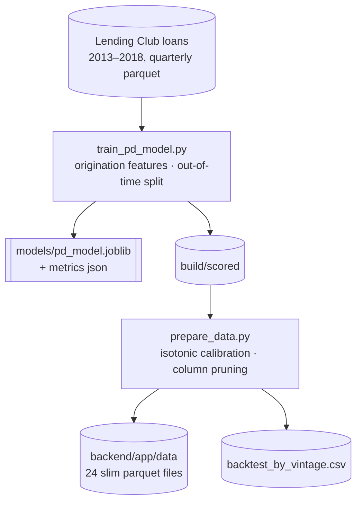
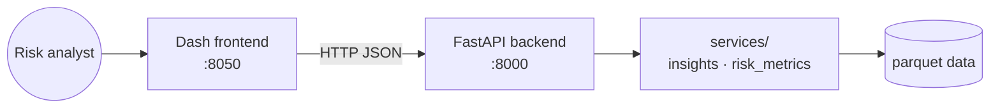

# Architecture

## Data and model pipeline (offline)

## Serving (online)

| Component | Technology | Hosting |
|---|---|---|
| Frontend | Dash, Plotly, Dash Bootstrap | Render free web service |
| Backend | FastAPI, pandas, SciPy, lifelines | Render free web service |
| Data | Parquet, zstd-compressed (~75 MB) | committed with the backend |
| CI | GitHub Actions: tests, lint, Docker builds | GitHub |

## Design decisions

- **Heavy work happens offline.** Training, scoring and the vintage backtest run in scripts, so the API stays within a free instance's 512 MB of memory.
- **PD buckets for VaR.** Loans are grouped into 200 PD buckets before simulation, so VaR takes about a second for 100,000+ loans with no loss of accuracy (loss is linear in exposure).
- **A closed-form check.** Every simulated VaR is returned with its closed-form Vasicek value, so a broken simulation shows up immediately.
- **Fail loudly.** Endpoints return HTTP 500 with the error instead of silently returning zeros.

## Scaling path (not needed for the demo)

- Move data to object storage (S3 or GCS) and query it with DuckDB.
- Schedule `prepare_data.py` monthly (GitHub Actions cron or Airflow) and alert when the backtest loss ratio or PSI drifts.
- Track model versions and metrics with MLflow.
