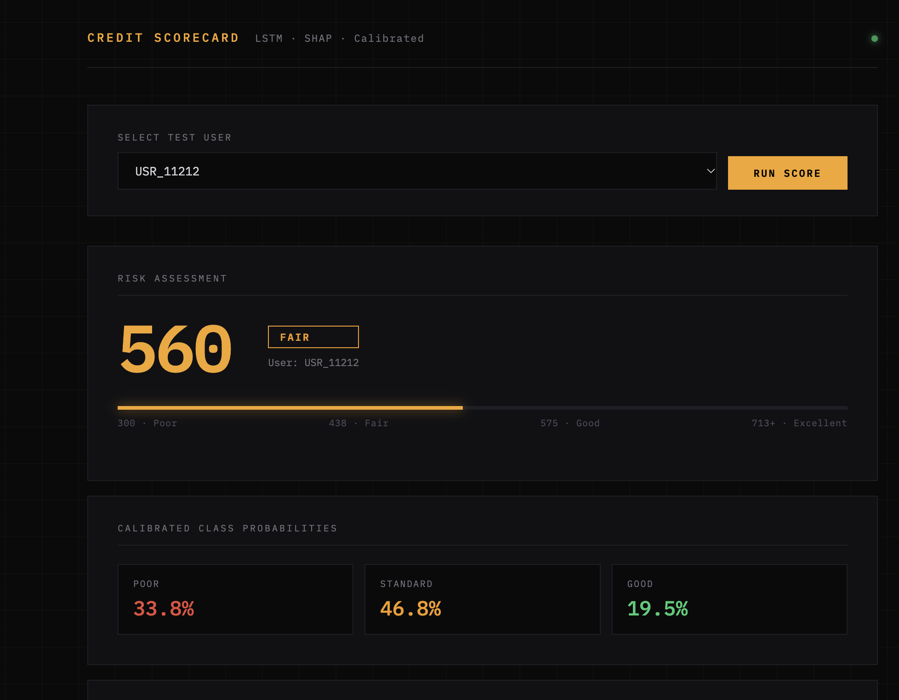

# Credit Risk Scorecard

**LSTM · Temperature calibration · SHAP reason codes · FastAPI**

A credit scoring service that returns, for any applicant, a 300–850 score, a risk band, calibrated class probabilities and the features that moved the score, each measured in score points.

<!-- TODO: record a 10-second GIF of the UI scoring a user, save as docs/demo.gif and uncomment

-->

## Results

Test set of 3,125 customers, three classes (Poor / Standard / Good):

| Model | AUC | Poor recall | Standard recall | Good recall | Poor rated as Good |
|---|---|---|---|---|---|
| LightGBM | 0.78 | 0.52 | 0.80 | 0.26 | 9 |
| LightGBM + sampling | 0.78 | 0.55 | 0.77 | 0.34 | — |
| XGBoost | 0.77 | 0.54 | 0.74 | 0.42 | — |
| **LSTM (selected)** | 0.74 | **0.68** | 0.43 | **0.71** | 141 |

**Why the LSTM was selected.** The tree models score well on AUC by defaulting to the majority Standard class. LightGBM misses 74% of Good customers and 48% of Poor ones. The class-weighted LSTM commits to the tails: it flags 140 more Poor customers and correctly serves 274 more Good customers than LightGBM.

**The trade-off, stated plainly.** The LSTM rates 141 Poor customers as Good, against 9 for LightGBM. In lending that is the costliest error, so the operating threshold should be chosen on expected cost, not recall alone (see *Next steps*).

<!-- TODO: fill in the "—" cells from the notebook confusion matrices -->

## How a score is built

### 1. Calibrated probabilities

Neural network outputs are usually overconfident. **Temperature scaling** learns one scalar *T* on the validation set, `p = softmax(logits / T)`. This corrects confidence without changing the ranking.

### 2. Score: points to double the odds (PDO)

The industry-standard scorecard scaling:

```
score = 600 + (50 / ln 2) × ln( P(Good) / P(Poor) )      clipped to 300–850
```

600 points means even odds of Good vs Poor, and **every 50 points doubles those odds**.

| Band | Score | Odds Good : Poor |
|---|---|---|
| Excellent | ≥ 650 | ≥ 2 : 1 |
| Good | 600–649 | 1 : 1 to 2 : 1 |
| Fair | 550–599 | 1 : 2 to 1 : 1 |
| Poor | < 550 | < 1 : 2 |

### 3. Reason codes in score points

`shap.GradientExplainer` (expected gradients) explains the model's raw logits. Because `ln(P(Good)/P(Poor)) = (logit_Good − logit_Poor) / T`, each feature's contribution converts **exactly** into score points:

```
points[f] = (50 / ln 2) × ( shap[f, Good] − shap[f, Poor] ) / T
```

The API returns the top 7 positive and negative drivers. The TF-IDF loan-type columns are summed into a single `Loan_Type` driver for readability.

### Model

```
Categorical columns → embeddings ┐
Numerical columns   → scaled     ┴→ LSTM (128) → dense head 64 → 32 → 3 (BatchNorm + dropout)
```

The model was trained with class-weighted cross-entropy, AdamW, gradient clipping and early stopping on validation AUC.

## Run it

```bash
pip install -r requirements.txt --extra-index-url https://download.pytorch.org/whl/cpu
uvicorn api.main:app --port 8001          # UI at http://localhost:8001, docs at /docs
pytest -q tests
```

With Docker:

```bash
docker build -t scorecard-api . && docker run -p 8001:8000 scorecard-api
```

| Method | Endpoint | Description |
|---|---|---|
| `GET` | `/` | Scorecard UI |
| `GET` | `/users` | Sample applicants |
| `POST` | `/score` | Score one applicant (JSON body: `user_id`, `features`) |
| `GET` | `/health` | Health check |

<details>
<summary>Example response</summary>

```json
{
  "user_id": "USR_7241",
  "risk_score": 641,
  "risk_band": "Good",
  "probabilities": {"Poor": 0.0821, "Standard": 0.4914, "Good": 0.4265},
  "top_positive_factors": [{"feature": "Credit_History_Age", "score_points": 38.5}],
  "top_negative_factors": [{"feature": "Outstanding_Debt", "score_points": -44.1}]
}
```
</details>

## Data

The [Kaggle Credit Score Classification](https://www.kaggle.com/datasets/parisrohan/credit-score-classification) dataset: about 100,000 monthly records, labelled **Poor / Standard / Good credit score**. The label is a credit-score category, not an observed default, so the model ranks creditworthiness rather than predicting loan losses. Loss prediction lives in [portfolio monitoring](../credit-portfolio-risk-monitoring/). Download the data into `data/credit_scoring_data/` (git-ignored).

## Repository layout

```
api/main.py            FastAPI service (model, calibration, SHAP, scoring)
api/index.html         scorecard UI
api/sample_users.json  50 demo applicants
artefacts/             model weights, temperature, encoders, SHAP background
notebooks/             EDA, model comparison, LSTM training
tests/                 API tests
```

## Demo



## Next steps

- **Cost-based threshold:** assign a cost to each error (Poor→Good ≫ Good→Poor) and choose decision thresholds on expected cost.
- **Calibration evidence:** reliability diagram and ECE before and after temperature scaling.
- **True sequences:** the data holds monthly records per customer. Feeding them as real sequences would let the LSTM learn from behaviour over time; today it sees a single step.
- **Fairness check:** compare approval and error rates across age bands and occupations.
